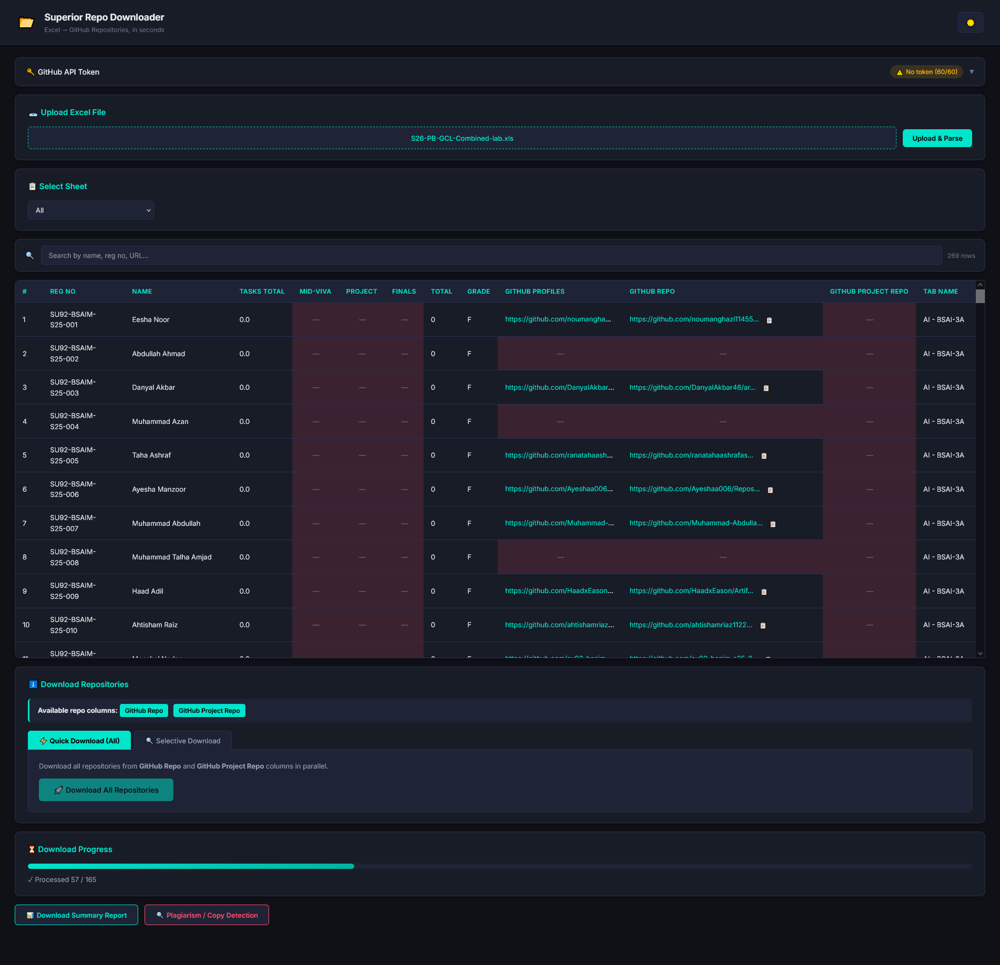

# Superior Students Repo Downloader

A comprehensive, web-based tool built to **automatically download multiple GitHub repositories** listed in Excel sheets, and to perform **advanced plagiarism detection** between student submissions.

Originally developed for managing student projects at **Superior University**, this powerful local application streamlines retrieving GitHub repositories from structured Excel sheets and features an intelligent Engine that performs deep code-similarity analysis.

---

## Features

### Bulk Downloader
- Upload `.xls` or `.xlsx` Excel files
- Automatically reads `GitHub Repo` and `GitHub Project Repo` URLs and downloads them in parallel
- Select specific sheets or process and filter selected repositories
- Fast, parallel downloading directly extracting the default branch
- Clean, searchable UI with data tables and toast notifications

### Plagiarism & Copy Detection
- **Multi-layered Plagiarism Engine**:
  - **Layer 1 (MD5 Hash)**: Detects exact byte-for-byte identical files.
  - **Layer 2 (AST Structure)**: Compares the Abstract Syntax Tree pattern of Python source code to detect logical copying even if variables and comments are heavily changed.
  - **Layer 3 (Text Similarity)**: Blazing fast Set-Jaccard validation text detection across frontend and backend syntax.
- Completely dynamic detection mechanism across groups of students.
- **Export directly to Excel (.xlsx)**: Generates a sorted Plagiarism Report with clear `Risk Levels` and detailed file-path evidence linking to identical copy sources.

---

## Screenshots

Here’s a quick preview of the app and its features:

### Upload Excel & Download repository


### Download summary report


### Plagiarism / Copy Detection


---

## Installation

1. **Clone the repository**
   ```bash
   git clone https://github.com/RasikhAli/Bulk-Git-Repo-Downloader.git
   cd Bulk-Git-Repo-Downloader
   ```

2. **Create a virtual environment (Recommended)**
   ```bash
   python -m venv venv
   # On Windows:
   venv\Scripts\activate
   # On macOS/Linux:
   source venv/bin/activate
   ```

3. **Install dependencies**
   ```bash
   pip install -r requirements.txt
   ```
   *(Note: Ensure `xlsxwriter` is installed: `pip install xlsxwriter` for exporting the Plagiarism Engine results)*

4. **Run the app**
   ```bash
   python app.py
   ```

5. **Open in browser**
   Navigate to `http://localhost:5000`

---

## Folder Structure

```
.
├── app.py                  # Main Flask backend & Plagiarism Engine
├── assets/                 # App Screenshots
├── downloads/              # Downloaded repositories organized by student
├── uploads/                # Temporary uploaded Excel files
├── templates/
│   └── index.html          # Main application UI
├── static/
│   ├── script.js           # Frontend interactions & Logic
│   └── styles.css          # Dark Mode GUI styling
├── requirements.txt
├── .gitignore
└── README.md
```

---

## Excel Format Guidelines

Your Excel sheets should contain a `GitHub Repo` or `GitHub Project Repo` column.  
The app also expects (but does not strictly require):
- `Reg No` (Registration Number)
- `Name` (Student Name)

---

## API Limits (Optional)

The app downloads public GitHub repos using direct zip connections without an API token, meaning there is no rate-limit on downloading files.
However, to use the **"Selective Download" (Fetch GitHub Profiles)** feature, GitHub limits anonymous users to 60 requests/hour. 
You can paste in a GitHub Token directly in the UI to increase this to 5,000 requests/hour.

---

## Built With

- **Python + Flask**
- **pandas & xlsxwriter**: For robust Excel parsing and Export Generation
- **requests**: For parallel GitHub .zip downloads
- **Python AST & Difflib**: For Abstract Syntax Tree and logical plagiarism discovery
- **Vanilla HTML/CSS/JS** with a custom responsive Dark Mode design

---

## License

This project is for educational and personal use.  
Feel free to modify and share with credit.

---

## Acknowledgments

Created by an instructor for the students of **Superior University**.  
Helping streamline project submissions and ensure academic integrity.
